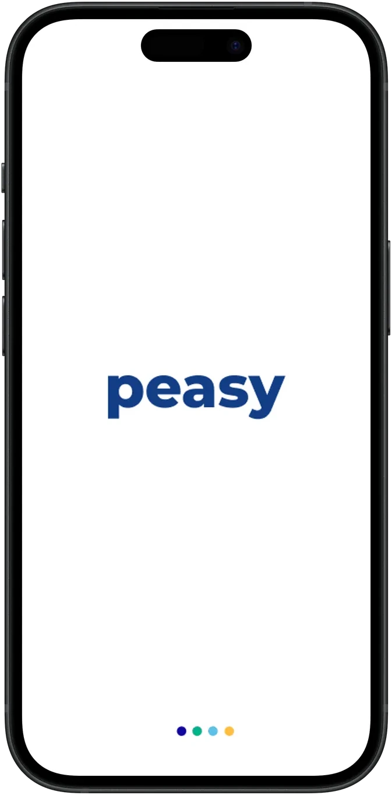
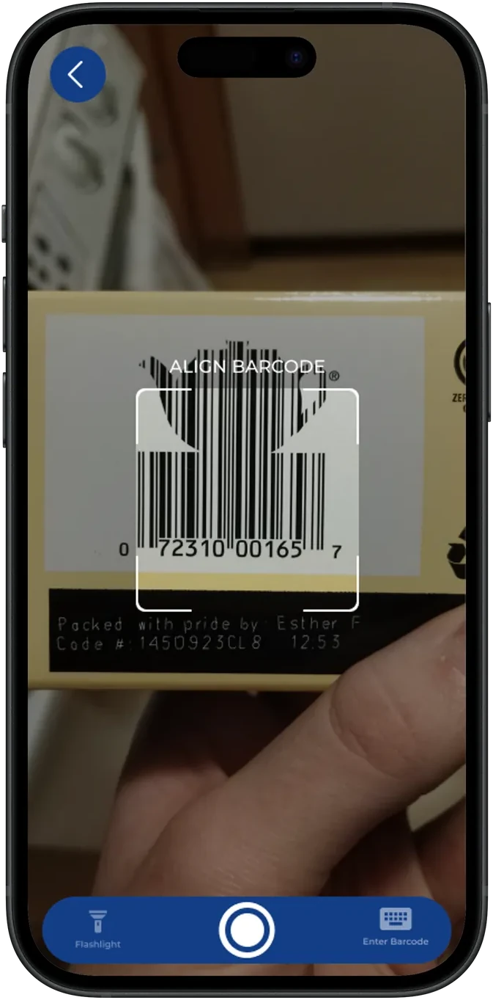
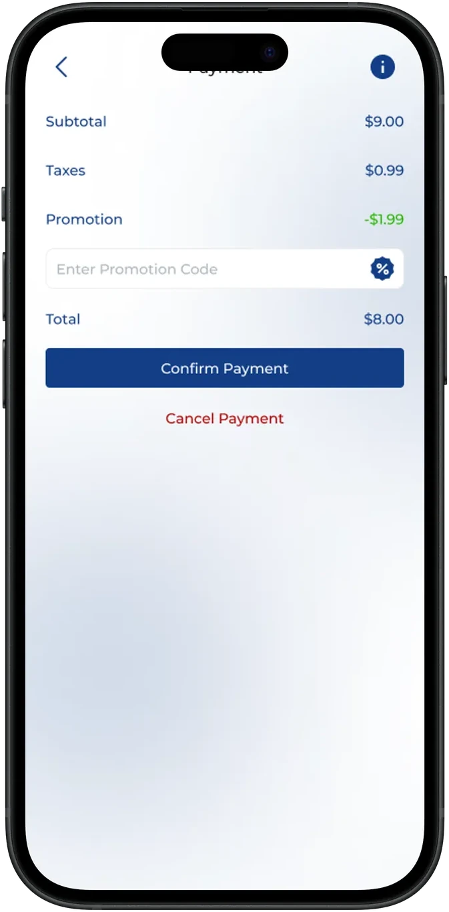
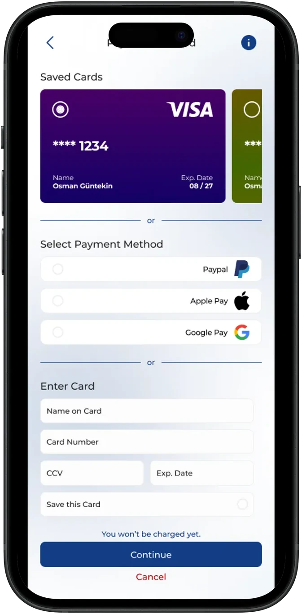

# Peasy — NFC Self-Checkout Mobile App

<div align="center">


### Frictionless in-store retail checkout powered by NFC and mobile payments.

[](https://flutter.dev)
[](https://dart.dev)
[](https://pub.dev/packages/nfc_manager)
[](https://stripe.com)
[](https://firebase.google.com)
[](https://flutter.dev)

[**Read the Case Study at ahmetkadircicek.com.tr →**](https://ahmetkadircicek.com.tr/projects/peasy)

<br/>

<p align="center">
  
  
  
  
</p>

</div>

---

## 🛒 Overview

**Peasy** is an innovative contactless self-checkout application developed as a university graduation capstone project. It allows shoppers in physical retail stores to tap their NFC-enabled smartphone against shelf product tags, automatically adding items with verified pricing to their digital basket, and completing payment in seconds via Stripe.

By bypassing conventional cashier lines, Peasy transforms retail store journeys into seamless grab-and-go experiences with digital receipts and instant exit validation.

---

## ✨ Features

- **Instant NFC Tag Reading**: One-tap hardware scan using `nfc_manager` with NDEF payload decoding and store ID validation.
- **Dynamic Digital Cart**: Real-time total calculation, promotional coupon application, quantity adjustments, and tax breakdown.
- **Secure Stripe Checkout**: Integrated credit card payments via Stripe SDK with 3D Secure verification.
- **Digital Receipt & Exit QR**: Generates an encrypted exit verification QR code after successful payment for store barrier or gate clearance.
- **Cloud Inventory Sync**: Live store inventory lookup and stock updates powered by Cloud Firestore.
- **Order History & Favorites**: Comprehensive transaction logs and quick re-order shortcuts for frequent store visits.

---

## 📲 How the NFC Flow Works

```
┌─────────────────┐       ┌─────────────────┐       ┌─────────────────┐
│  Shelf NFC Tag  │  ──▶  │  Peasy Scanner  │  ──▶  │ Firestore Cloud │
│ (NDEF ProductID)│       │  (nfc_manager)  │       │ (Price & Stock) │
└─────────────────┘       └─────────────────┘       └─────────────────┘
                                                             │
                                                             ▼
┌─────────────────┐       ┌─────────────────┐       ┌─────────────────┐
│ Exit Pass (QR)  │  ◀──  │ Stripe Checkout │  ◀──  │   Cart Total    │
│ & PDF Receipt   │       │ (3D Secure Pay) │       │ (Items + Taxes) │
└─────────────────┘       └─────────────────┘       └─────────────────┘
```

---

## 🏛️ Project Structure

```
lib/
├── core/                 # App configurations, constants & themes
│   ├── constants/        # Stripe keys, NFC tag prefixes, Firestore collection names
│   ├── services/         # NFC scanner service, Stripe payment service, Auth service
│   └── utils/            # Currency formatting, QR generator helpers
├── models/               # Domain data models (Product, CartItem, Order, User)
├── providers/            # State management providers for Cart, User, and Scanner
├── screens/              # UI screens (Home, NFC Scanning Modal, Cart, Payment, Receipts)
└── widgets/              # Reusable UI components (ProductCard, NDEFScanAnimation, ReceiptTile)
```

---

## 🚀 Getting Started

### Prerequisites
- Flutter SDK `^3.16.0` or higher
- Physical iOS (iPhone 7+) or Android device with active NFC hardware (NFC scanning does not run on simulators)
- Stripe developer test account

### Installation

```bash
# 1. Clone repository
git clone https://github.com/ahmetkadircicek/peasy.git
cd peasy

# 2. Install dependencies
flutter pub get

# 3. Connect a physical smartphone with NFC enabled
flutter run
```

---

## 👨‍💻 Project Team & Credits

- **Ahmet Kadir Çiçek** — Mobile Flutter architecture, NFC hardware integration & Stripe payments ([ahmetkadircicek.com.tr](https://ahmetkadircicek.com.tr))
- Developed as a graduation capstone project at Kadir Has University.

---

## 📄 License

This repository is licensed under the [MIT License](LICENSE).
